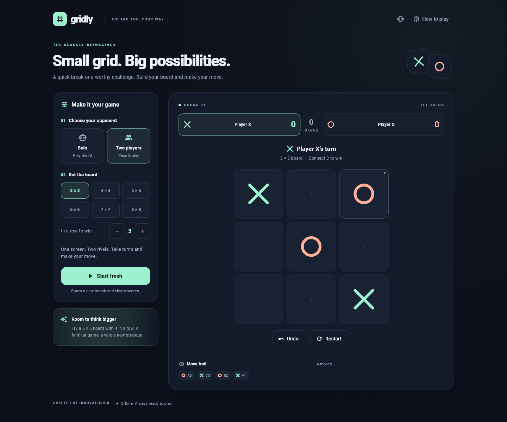

# Gridly · Tic Tac Toe

A Flutter game by **InnovatixHub**, with a midnight navy interface, mint Xs, coral Os, and hand-drawn animated marks.

**Android application ID and iOS bundle ID:** `innovatixhub.in.tictactoe`



## Play your way

- **Custom grids:** 3 × 3 through 8 × 8; independently choose a consecutive win length from 3 to the board size.
- **Solo or local multiplayer:** challenge the AI or pass the device to a friend.
- **Three AI levels:** random moves on Easy, tactical wins and blocks on Medium, perfect minimax play on Hard 3 × 3. Larger Hard boards use a bounded tactical search and can be beaten.
- **Complete match flow:** animated winning lines, confetti, draws, scores, alternating starting marks, round restart, and the eight most recent moves.
- **Useful undo:** return to your previous turn, including undoing the AI response; pending AI moves are cancelled safely. Completed rounds are final.
- **Responsive controls:** side-by-side setup on desktop, a settings sheet on phones, and pinch zoom on boards larger than 4 × 4.
- **Accessible interaction:** semantic board coordinates, keyboard-focusable controls, live turn announcements, scalable text, reduced-motion support, and optional haptics.
- **Self-contained assets:** bundled fonts and custom launcher icons. No runtime packages beyond Flutter, accounts, ads, or game server.

Settings, scores, and the current match are kept in memory for the session. Native gameplay works offline. The web build must be served over HTTP; web assets are bundled locally when built using the command below.

## Run

Built with Flutter **3.44.8** / Dart **3.12.2**. Install Flutter and the platform toolchain, then:

```powershell
cd innovatix_tictactoe
flutter pub get
flutter run
```

For a browser:

```powershell
flutter run -d chrome
```

Open this directory directly in Android Studio or VS Code as a Flutter project. The new project is an independent local Git repository inside the existing workspace.

## Verify and build

```powershell
dart format --output=none --set-exit-if-changed lib test tools/preview_test.dart
flutter analyze
flutter test
flutter build apk --release
flutter build web --release --no-web-resources-cdn
```

The upload-key-signed release APK is written to `build/app/outputs/flutter-apk/app-release.apk`. Run `powershell -NoProfile -ExecutionPolicy Bypass -File tools/build-release.ps1` to build both Android formats with the filenames `build/distributions/tictactoe.aab` and `build/distributions/tictactoe.apk`. Browser output is in `build/web/`. Preview it with `node tools/serve.mjs`, then open `http://127.0.0.1:4173`.

iOS source is included. Building and signing iOS requires macOS and Xcode. Android release builds use the password-protected `tictactoe.jks` upload key through `android/tictactoe.properties`. The encrypted keystore is versioned at the owner's request; the password properties remain excluded from Git. See [signing and Play Console instructions](docs/signing.md) before uploading an existing app update.

## Game rules

A win requires consecutive marks horizontally, vertically, or diagonally. Longer lines also win. A full board without a winner is a draw. X opens the first round; the starting mark alternates in subsequent rounds. Choosing **Start fresh** applies the draft settings and clears the match scores. **Restart** clears only an unfinished round and preserves scores.

The AI waits briefly before moving. Human taps during the AI turn are ignored. Undo, restart, changing settings, and disposing the game cancel pending AI work.

## Source layout

| Location | Purpose |
| --- | --- |
| `lib/game/engine.dart` | Configuration, marks, winning windows, and computer strategy |
| `lib/game/controller.dart` | Turn management, AI scheduling, undo, rounds, and scores |
| `lib/ui/arena.dart` | Responsive match screen, score cards, help, and move trail |
| `lib/ui/config_panel.dart` | Opponent, grid, win length, difficulty, and mark selection |
| `lib/ui/board.dart` | Interactive cells, painted marks, win line, and celebration |
| `lib/ui/theme.dart` | Shared colors, typography, and component themes |
| `test/` | Rules, exhaustive Hard 3 × 3 AI, controller, and responsive interaction tests |
| `tools/preview_test.dart` | Renders desktop and phone screenshots from the actual Flutter widgets |
| `branding/` | Original vector icon and high-resolution PNG |

The rules engine has no Flutter dependency. Large-board AI first checks immediate wins and blocks, then searches up to 12 candidate moves and 12 responses. It runs synchronously after a short timer; the bounded search is intended for these boards of at most 64 cells.

Regenerate the screenshots:

```powershell
flutter test tools/preview_test.dart --update-goldens
```

Regenerate launcher icons on Windows:

```powershell
powershell -NoProfile -ExecutionPolicy Bypass -File tools/generate-branding.ps1
```

Roboto font files and their Apache 2.0 license are included in `assets/fonts/`.
